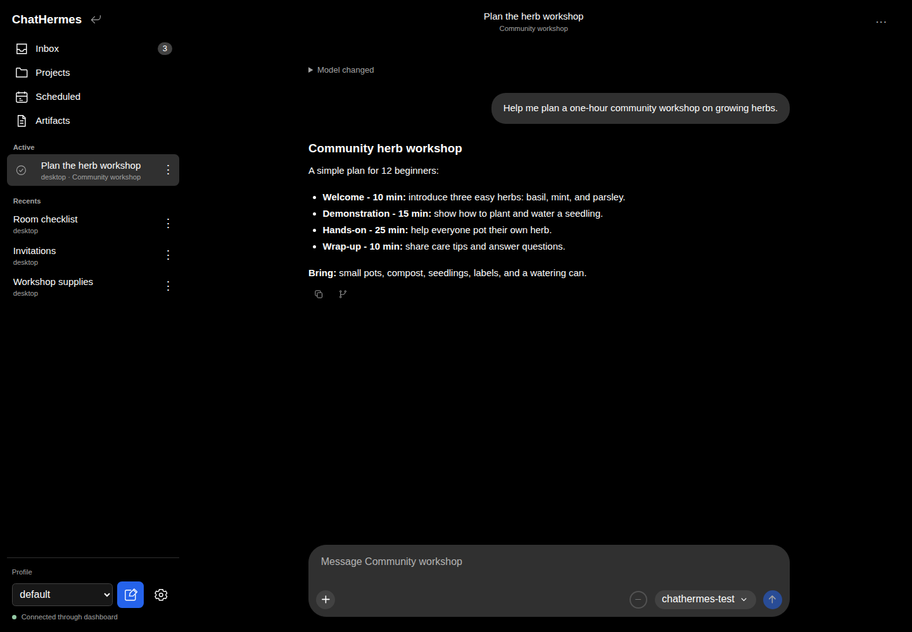
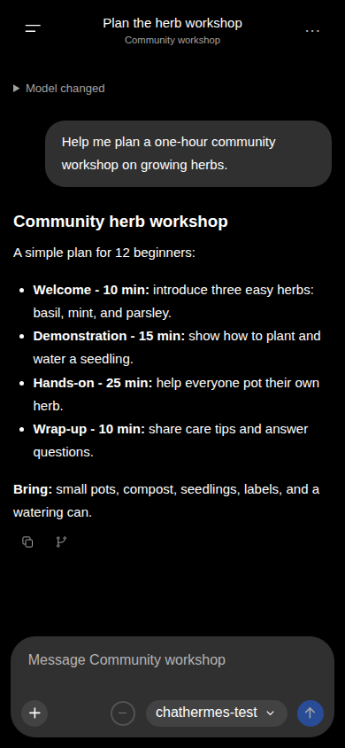

# ChatHermes

A mobile-friendly chat plugin for the [Hermes Agent](https://github.com/NousResearch/hermes-agent) dashboard. Chat with your existing agents, profiles, and Projects from your phone or desktop, using Hermes dashboard authentication.

- Stream responses with thinking and tool activity you can inspect.
- Switch profiles, providers, and models; resume saved conversations.
- Browse Projects, edit project instructions, and preview or download artifacts.
- Read scheduled job results and enable per-profile Web Push notifications.
- Attach files, images, or a camera photo on supported devices.

| Desktop                                                                                                                                                            | Mobile                                                                                                                                          |
| ------------------------------------------------------------------------------------------------------------------------------------------------------------------ | ----------------------------------------------------------------------------------------------------------------------------------------------- |
|  |  |

_The same conversation on desktop and mobile in the Hermes dashboard, using fictional workshop data and a test model._

## Quick install

With Hermes and its dashboard installed:

```sh
hermes plugins install abauman97/ChatHermes#plugin/chathermes --enable
```

Accept the Python dependency prompt, configure the [Hermes API server](docs/user/configuration.md#hermes-api-server), restart the dashboard, and open **ChatHermes**.
See [installation](docs/user/installation.md) for the full procedure and an agent-assisted setup prompt.

## Requirements and compatibility

ChatHermes runs inside the Hermes dashboard. Its reviewed native gateway contract targets Hermes **0.22.5**; incompatible runtimes block sending. The plugin dependency package requires Python **3.11+**. Remote Web Push requires trusted HTTPS, with additional [iOS Home Screen requirements](docs/user/notifications.md).

## Guides

- [Get started](docs/user/getting-started.md) · [Features](docs/user/features.md) · [Troubleshooting](docs/user/troubleshooting.md)
- [Configuration](docs/user/configuration.md) · [Notifications and Cron delivery](docs/user/notifications.md)
- [Developer setup](docs/developer/getting-started.md) · [Contributing](CONTRIBUTING.md)
- [All documentation](docs/README.md), including architecture, testing, deployment, and historical records
