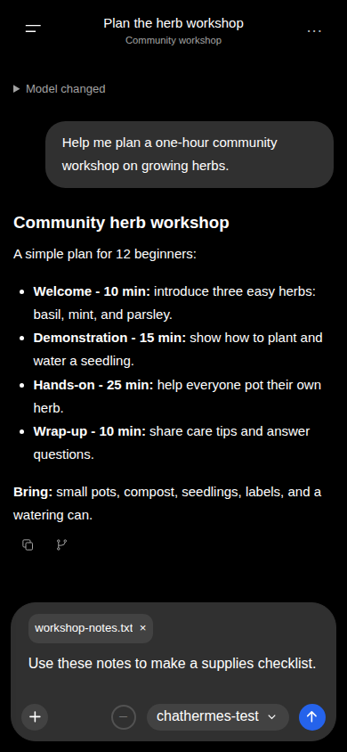
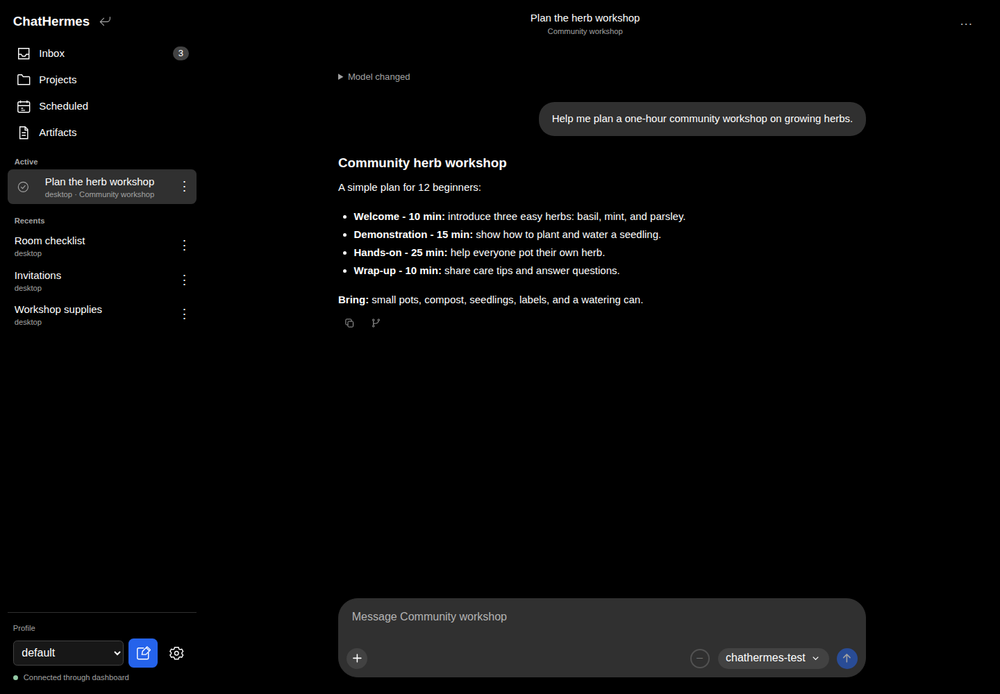
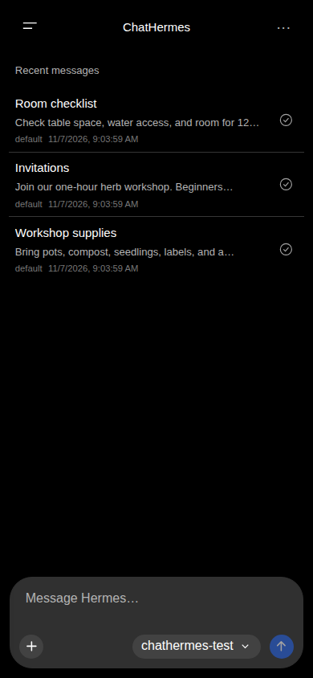
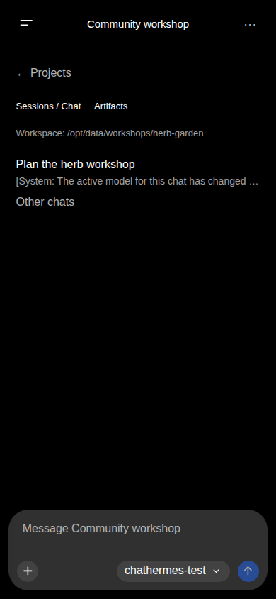
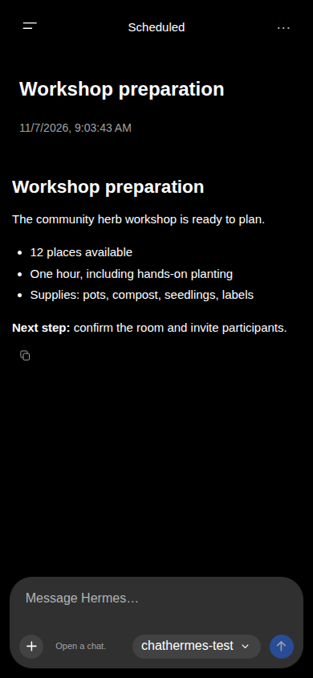

# Use ChatHermes

## Chats and attachments

Use the drawer to open a saved chat, or **New chat** to start another. Switch profiles to see that profile's conversations. Select the provider and model before sending; selections affect the session runtime.

The model picker also has a **Reasoning effort** select. Choose None, Minimal, Low, Medium, High, XHigh, Max, or Ultra before sending. Explicit choices apply to that chat after its model is selected; they do not change other chats or profile defaults. **Model default** uses the selected model’s configured reasoning setting without adding an explicit override. Hermes controls the model's supported levels and may map a requested level to a supported one or omit reasoning for models that do not support it. Unsent picker choices are held for the current page visit; saved chats restore their runtime model and reasoning settings.

Attach files or images with the composer, drag files onto the chat, or use camera capture where supported. Failed uploads can be retried or removed without losing the draft. Uploads are limited to 20 MB decoded per file. Images retain their originals for later viewing. Other files are made available to the agent in the selected profile's filesystem.

_Attach a file before sending. Remove it with the × beside its name if you change your mind._

Saved chats open at their latest messages. Scroll toward the top to load older history, or use **Show earlier messages**. Earlier messages remain available after context compaction and session rotation; **Context compacted** dividers mark persisted compression boundaries. Internal summaries and rewound messages stay hidden. Loading older messages preserves your reading position.

Thinking and tool disclosures show the activity Hermes provides. Details stay collapsed by default, even while active. Expand a disclosure to inspect streaming or completed work. Approvals and clarification requests appear in the conversation; respond there to continue.

Use **Copy response** below a completed reply to copy its text. **Branch in new chat** starts a separate conversation containing the history through that reply, preserving its profile and Project workspace. Branching is available when the chat is ready.

_The same conversation on desktop, with navigation alongside the chat._

## Home and Inbox

ChatHermes opens Home with the latest five unread messages across accessible
profiles. Open a message to visit its chat or linked Kanban task. Use the
check-circle beside a message to remove the notification without opening it; Home
refills the preview with the next unread message. Removing a notification leaves
the conversation and any pending request available.

Open **Inbox** for the full unread list. Choose **All profiles** or the current
profile in the **View** selector, and use **Load More** for older notifications. You can
also remove notifications here. The composer remains available for drafting on
Home and Inbox.

Sidebar chats with an unread Inbox notification have a dot and a semibold title.
Indicators belong to the selected profile and clear when the notification is read,
removed, or the chat opens successfully. Unread state does not change Active or
Recents grouping or chat order.

While Hermes is working, the chat's sidebar title shimmers. It stays marked while
Hermes waits for approval or clarification, and stops when the turn finishes or
is stopped. Reduced motion shows a static title with the same Working label for
screen readers. Working and unread indicators can appear together; neither
changes your selection or manual Active tracking.

_Home previews recent unread messages. Open an item to visit its conversation, or use its check-circle to remove the notification._

## Active and recent chats

New chats created in ChatHermes start **Open** and appear in **Active**, newest
activation first. Active includes older chats beyond the current history page.
Existing Hermes chats remain untracked until you choose **Make active** in their
ellipsis menu. Click or tap the check-circle beside an Active chat, or choose
**Mark settled** in its menu, to move it to chronological **Recents**. Settled
and untracked chats can be made active again.

Tracking is saved per Hermes profile across reloads and devices. It is manual:
sending messages, completing work, or reconnecting does not change it. Settling
keeps the conversation available and allows running work to continue. Archiving
hides a chat while retaining its tracking; deleting removes the metadata.
Compaction carries the status to the continuation chat.

## Projects and instructions

Open **Projects** and select a Project to view its workspace and recent chats. Hermes supplies Projects, including automatic repository Projects and Home.

The Projects **···** menu has **Hide automatic projects**, enabled by default.
Turn it off to include discovered workspaces in the active and archived lists.
This preference is saved in this browser for all profiles. Explicit Projects and
conversations are preserved; hidden Projects still open through existing links
and their conversations.

Choose **Archived projects** in the Projects **···** menu to browse archived
workspaces. After opening one, use **Projects** in the sidebar to return to the
archived list. Choose **Active projects** in the list menu to switch back.

Use **New Project Chat** to create a distinct chat in the selected Project workspace. In an open chat, **New chat** starts an unscoped chat; on Project home it retains scoped creation. Home starts without a Project workspace. A Project without an available workspace cannot start a chat.

Browsing another Project changes the view while retaining the current chat's workspace. Resuming an existing chat always uses its saved workspace. Use **New project** on the Projects page to create a Project, optionally supplying a folder path on the Hermes server. In a Project’s **···** menu, **Edit project** lets you change its details and folders; the primary folder is used for new chats. Saved Projects can be archived, restored, or deleted from that menu. Automatically discovered workspaces offer **Save project** before their details can be managed.

To add an existing chat to a Project, open the chat’s ellipsis menu in the drawer, choose **Add to project**, select the destination, and choose **Add**.

_A Project keeps related conversations together. Its workspace folder is on the Hermes server._

Use **Edit Instructions** in the Project’s **···** menu to load and save the workspace instruction file. It edits the first existing supported instruction file, or creates `.hermes.md` when none exists. It does not edit inherited instructions in parent directories. If the file changes elsewhere, reload and reconcile your draft before saving. Hermes loads instructions through its normal context loader.

## Artifacts

Open a file card in a conversation, or browse **Artifacts** globally or within a Project. Images have thumbnails and a larger viewer; PDFs and supported media use browser viewers. Text, HTML, and SVG display as escaped source; other files offer download.

The library shows its first 50 indexed files immediately. Use **Load More** for
older files and **Refresh** to read the latest index. Existing conversations are
indexed in the background; newly delivered files may take a moment to appear.

Artifacts come from delivered-file references and uploads in saved history. Assistant replies can also deliver a standalone absolute or `~/` file path, or a Markdown link to it, for supported document, image, media, data and archive types. The file must exist and pass Hermes’s access checks. Paths discussed in prose, quoted examples, code, thinking, tool output and user context do not automatically create artifacts. Preview and download use the authenticated dashboard and the chat's profile/workspace. Confirm deletion only when you intend to remove the actual managed file. Historical references remain afterward; remote SSH deletion is unsupported.

## Scheduled results

Open **Scheduled** in the drawer and select Active, Paused, or Completed. Select a job, then a dated run to read its final assistant response. Runs appear newest first; load older pages as needed. Intermediate responses, thinking and tool activity are hidden. Length-framed saved agent documents show only their response, without the job header or assembled prompt. Older unframed archives, including failed-run diagnostics, show a boundary warning because their contents cannot be safely separated; inspect the original archive on the Hermes server. Script runs show their saved output.

If the run has an associated session, choose **Resume Session** in the **···** menu to open that conversation. Runs with saved output only do not offer this action. Create, schedule, pause, or modify jobs in Hermes's native dashboard. Deleted jobs and pruned output cannot be recovered.

_Select a dated run to read its saved result. This example shows a fictional preparation report._

To receive Cron notifications, [configure ChatHermes delivery](notifications.md#enable-cron-delivery).

## Share and reopen links

Use the current page URL to reopen a chat, Project, or scheduled run under dashboard authentication. Canonical links use a hash, such as `/chathermes?profile=default#/chat/session_123?profile=default`. Older query-only page/session links are no longer interpreted; reopen the destination through the drawer to obtain a current link.

## Kanban Viewer

In **Settings → Global settings**, enable **Kanban Viewer** to show **Kanban** in
navigation. It shares a card with **Keep Screen Awake**. It starts disabled and is saved in this browser for all chat profiles.
The toggle is unavailable when the dashboard cannot access Hermes's Kanban API;
use **Recheck availability** after enabling Kanban in Hermes or signing in again.
Kanban uses the dashboard's backend, independently of your selected chat profile.

Choose a board without changing Hermes's CLI/global current board. Use the screen
**···** menu to refresh, create boards, open **Board settings**, or show archived tasks.
Use **New task** beside the board selector to create a task, optionally choosing
**Start in triage**. Hermes controls initial placement and dispatch. Board settings let you edit the name, description and
backend default directory, or archive a non-default board. Create and edit tasks,
assign priority and profile, and optionally override
model/provider and reasoning effort for the next worker run. A blank override
inherits the assigned profile. Reassigning a task releases any active worker claim.

Select a task to inspect dependencies, comments, attachments, activity, worker log,
run history and results. Add comments, upload/download/remove attachments, archive,
restore or permanently delete a task. On desktop, drag cards between eligible
columns; on mobile, use **Move task** in the task details. Hermes supplies the
allowed move targets and enforces dependencies and lifecycle rules. Running,
scheduled and review are not offered as drag targets. During dispatch, Hermes
can immediately promote a dependency-free Todo task back to Ready.

Changes from Hermes's other clients arrive through its event stream, with an
eight-second refresh fallback. Reads pause in hidden tabs. If Kanban becomes
unavailable, the viewer closes its subscriptions while chat continues working.

This integration covers core board and task operations. For board project binding,
board archive transfer, bulk operations, orchestration/profile configuration,
AI-assisted specification/decomposition/estimation, dependency editing,
review/scheduling handoffs, workspace/runtime/skills/goal configuration, and
advanced diagnostic or execution controls, use Hermes Desktop or CLI.
