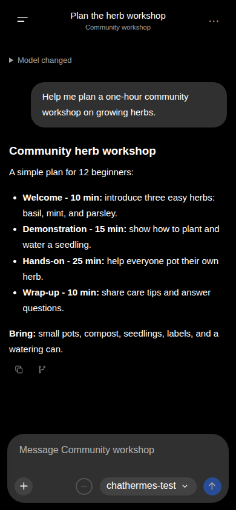
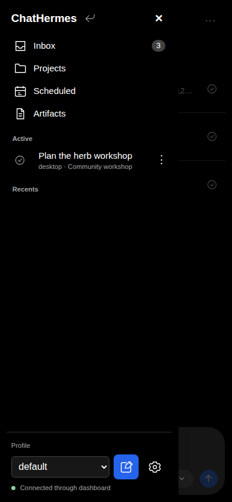

# Start chatting

1. [Install ChatHermes](installation.md), restart Hermes's dashboard, and open **ChatHermes** from the dashboard. Home opens by default with a preview of recent unread messages; links to specific pages or chats still open their destination.
2. Select the Hermes profile you want to use. Optionally choose a provider and model.
3. Type in the rounded composer and use the send button to send. On desktop, **Enter** sends and **Shift+Enter** adds a new line. On mobile, **Enter** adds a new line. Your first send starts a native Hermes session. Thinking and tool details stay collapsed by default, including while active; expand them to inspect arriving data. Your disclosure choices persist as the response completes.
4. Use **Stop** to interrupt work. The composer remains editable while a request runs; sending is enabled only when the session is ready.
5. Open the drawer to resume a chat or browse Projects, Artifacts, and Scheduled results.

_A first conversation on mobile. The examples in these guides use fictional workshop data and a test model._

Files and camera photos can be attached before sending. Review [features](features.md) for workspace behavior and attachment limits, and [notifications](notifications.md) to receive results when away.

_Open the navigation drawer to find your chats and other pages. Settings is at the bottom._

If the connection drops, reopen the saved chat and let Hermes restore its state. An unknown send outcome is never automatically retried; inspect history before manually sending again. See [troubleshooting](troubleshooting.md).
